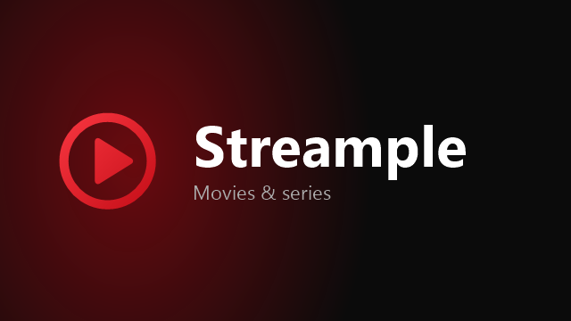

<p align="center">
  
</p>

<p align="center">
  <b>Simple streaming for Android TV.</b><br>
  Netflix-style browsing and recommendations, powered by Stremio add-ons.
</p>

<p align="center">
  <a href="https://github.com/yergerb/streample-releases/releases/latest"></a>
  
</p>

---

> [!WARNING]
> **Honest disclaimer: this is AI slop.** I'm not a developer. I built Streample for my own TV by describing what I wanted to an AI, which wrote all of the code. It works well on my NVIDIA Shield, but nobody has reviewed the code, it hasn't been tested much beyond my own setup, and there's no support, roadmap or promise that anything keeps working. Use it if it's useful to you, at your own risk.

Streample is a TV app for watching movies and series. It looks and feels like the big streaming apps: a home screen of rows, a spotlight with artwork, and one Play button that picks a good source for you. Streample hosts nothing itself. The catalog comes from Cinemeta and TMDB, sources come from Stremio add-ons you choose (like Torrentio), and Real-Debrid and Trakt are optional extras.

## What it does

**Home that knows you**
- Continue Watching, My List, and **New Episodes** of the shows you follow
- **Top Picks for You**: a fresh mix every time you open the app, based on what you watch, blended with Trakt's recommendations
- Trending movies and series, and "Because You Watched …" rows
- Movies and Series pages with dozens of categories, and rows that keep loading as you scroll

**Title pages**
- Logo art, synopsis, trailer, and quality badges (**4K, Dolby Vision, HDR, Atmos, ⚡ Instant**) based on the sources actually available
- IMDb rating, plus **Rotten Tomatoes** and **Metacritic** scores (with a free OMDb key)
- Seasons and episodes, **film collections in order** (every Spider-Man film, every John Wick), More Like This
- Cast & crew with character names. Pick anyone to see everything they've been in.
- Mark movies, episodes or whole seasons as watched

**Playback**
- **One-press Play** picks the best source: instant Real-Debrid links first, your preferred quality, HDR, and never cam rips
- **Smart fallback:** if a source fails or keeps buffering, it moves to the next best one at the same spot
- **Skip Intro / Skip Recap** and a **Next Episode** button as soon as the credits start
- **Matches the TV's frame rate** (24 Hz for films, no judder) and **passes surround sound through** (Dolby Digital, Atmos, DTS) to your soundbar or receiver
- Subtitles from OpenSubtitles, audio and subtitle language preferences, sync offsets, speed and zoom
- Resume where you left off, or start over
- Two players built in (ExoPlayer and VLC) with automatic switching, so practically every file plays

**Search**
- Press the mic button on your remote and just talk
- Finds titles and people. Search "Tom Hanks" to get his films.

**Works without Real-Debrid.** Streample can stream torrents itself. Speed depends on seeders, and your own connection shares data with other peers while you watch, as with any torrent client.

**Trakt sync (optional).** Brings in your watch history and in-progress shows, marks what you watch, keeps My List and your Trakt watchlist in sync both ways, and sends your thumbs up/down as ratings.

**Android TV home screen.** What you're watching shows up in the system's Play Next row.

## Install

It should run on any Android TV, Google TV or Fire TV device (Android 7.0+), but it has only really been tested on an NVIDIA Shield.

**1. Pick the right file**

| Your device | Download |
|---|---|
| NVIDIA Shield, newer Google TV boxes | [`streample-arm64-v8a.apk`](https://github.com/yergerb/streample-releases/releases/latest/download/streample-arm64-v8a.apk) |
| Fire TV Stick, Chromecast with Google TV, most TV sticks | [`streample-armeabi-v7a.apk`](https://github.com/yergerb/streample-releases/releases/latest/download/streample-armeabi-v7a.apk) |
| Not sure | [`streample-universal.apk`](https://github.com/yergerb/streample-releases/releases/latest/download/streample-universal.apk) (bigger, works everywhere) |

**2. Get it onto the TV**

- **Easiest:** install the free **Downloader** app on your TV and enter the link from the table. It always points to the newest version.
- **From a PC:** turn on Developer options and Network debugging on the TV, then:
  ```
  adb connect <tv-ip>:5555
  adb install streample-arm64-v8a.apk
  ```
- Or copy the APK with a USB drive or an app like *Send Files to TV*.

Android will ask you to allow installing apps from that source. That's expected for apps outside the Play Store.

**3. Updates come to you.** When a new version is out, Streample offers it the next time you open it. One press installs it, and your settings and history stay as they are.

## First-time setup

On first launch a short setup walks you through each service. **Every step can be skipped and changed later in Settings.** To avoid typing long keys with a remote, scan the QR code on screen and paste them from your phone.

| Service | What it adds | Cost | Where to get it |
|---|---|---|---|
| **Torrentio** | Sources to play (installed with one button) | Free | Built into setup |
| **Real-Debrid** | Instant, buffer-free streams from cached links | Paid | [real-debrid.com/apitoken](https://real-debrid.com/apitoken) |
| **Trakt** | History, recommendations, sync, ratings | Free | [Create an app](https://trakt.tv/oauth/applications/new) (redirect URI `http://localhost`) and copy its Client ID |
| **TMDB** | Cast photos, actor pages, collections, theme categories | Free | [themoviedb.org/settings/api](https://www.themoviedb.org/settings/api) |
| **OMDb** | Rotten Tomatoes and Metacritic scores | Free | [omdbapi.com/apikey.aspx](https://www.omdbapi.com/apikey.aspx) |

Your keys stay on your TV. They're never built into the app or sent anywhere except the service they belong to. The phone setup page can also **back up and restore** everything (settings, keys, history, My List) as one file.

## Remote cheat sheet

| Where | Press | Does |
|---|---|---|
| Anywhere | Mic / Search button | Voice search |
| Anywhere | ← at the left edge | Opens the menu |
| Home | Hold OK on a Continue Watching card | Removes it from the row |
| Title page | Hold OK on an episode | Marks it watched / unwatched |
| Player | OK | Pause / play |
| Player | ← / → | Back / forward 10 seconds |
| Player | ↑ / ↓ | Show controls (audio, subtitles, options) |
| Player | ↑ to the progress bar, then hold ← / → | Scrub. Steps grow from 10 s to 5 min. |
| Player, intro playing | OK | Skip Intro |
| Player, credits | OK / Back | Next episode now / keep watching |
| Player, end of a movie | ▲ / ▼ | Thumbs up / thumbs down |

## Good to know

- **No sound?** Your TV or soundbar may not support passthrough for that format. Turn off *Surround passthrough* in Settings → Playback.
- **Screen goes black for a second when a movie starts?** That's the TV switching to the film's frame rate. You can turn it off with *Match frame rate*. On a Shield, also turn on *Match content dynamic range* in the Shield's own display settings so HDR switches too.
- **Something crashed?** Streample saves a report. Open the phone setup page from Settings and choose *Crash reports* to read or share it.

## Disclaimer

Streample doesn't host, store or distribute any content. It's a player and browser for metadata and for add-ons that you choose to install. You're responsible for what you stream and for following the laws where you live.
